## Memoria

dsds

sd

sd

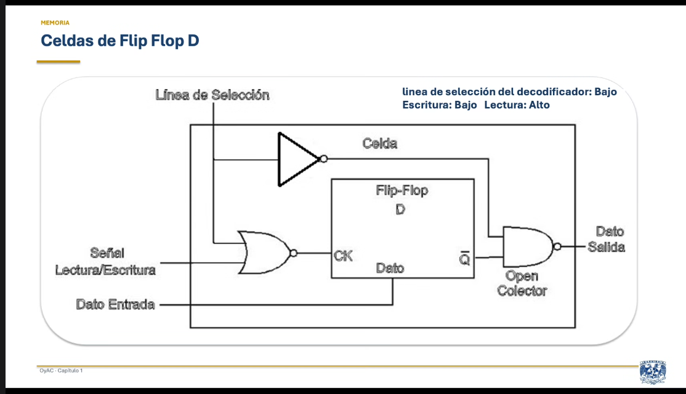

Fipflop D

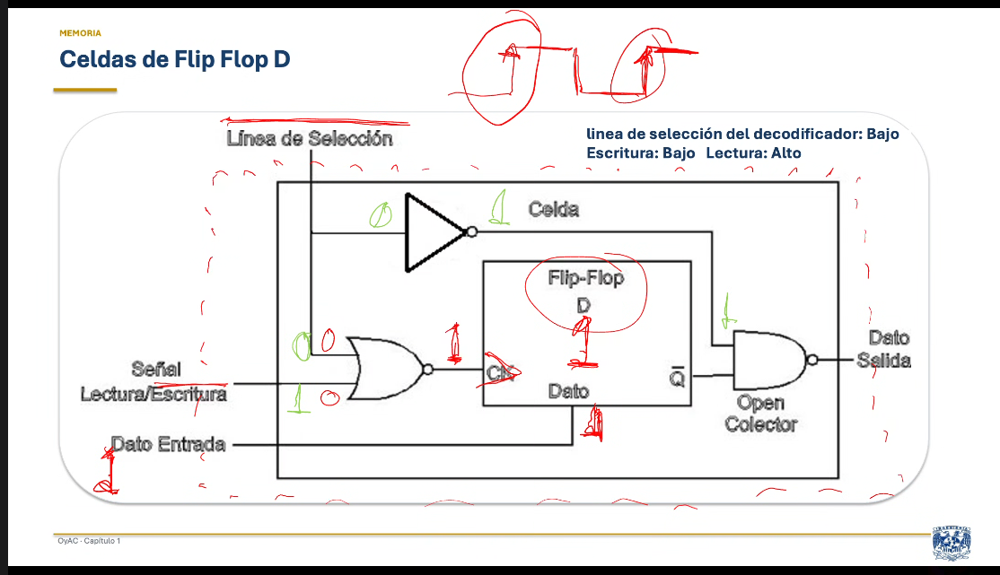

# Memoria secundaria

## medios magneticos

grabacion en medio magnetico

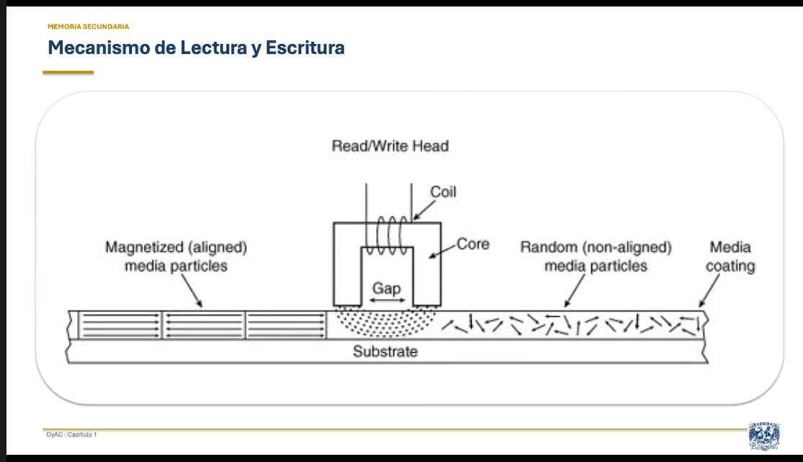

Puntos de cambio abrupto

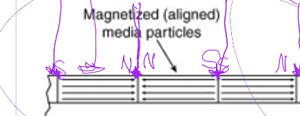

esas inflexiones significan algo en el código

Mecanismo de lectura escritura

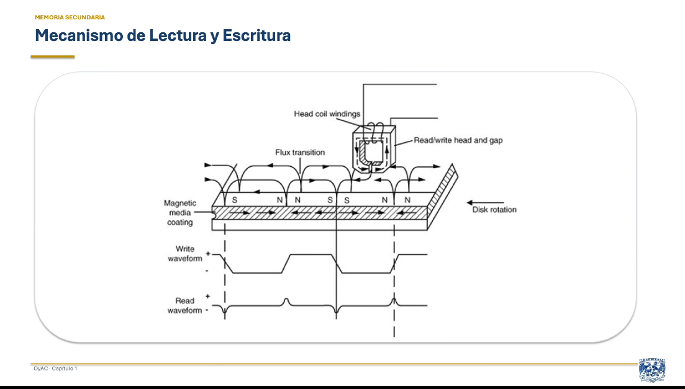

### Códigos de grabación

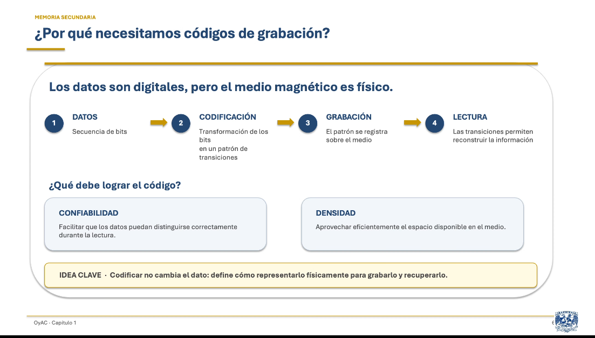

**Objetivos de un código**

- Densidad

- Confiabilidad

Tipo

- FM

Transición o no transición a la mitad del tiempo de relog **T** no transición **N**

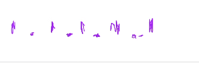

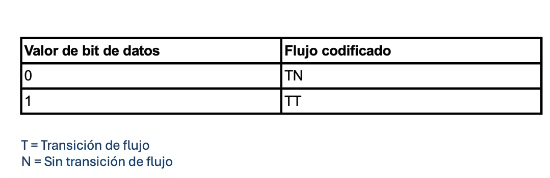

- MFM

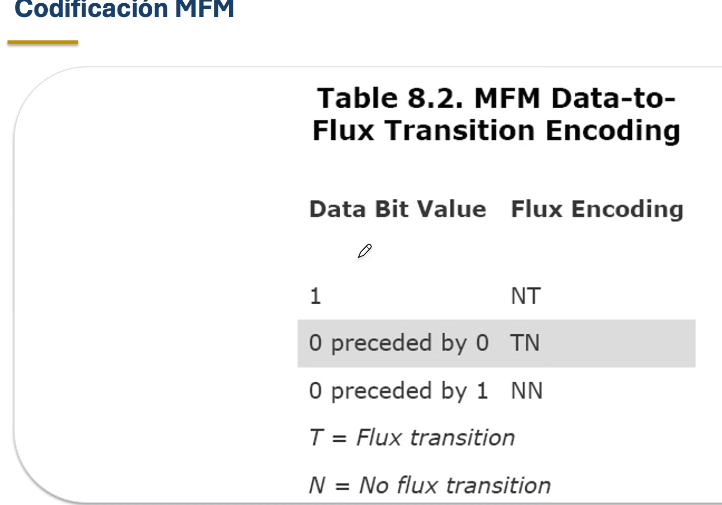

- RLL

7 combinaciones disponibles; entre 2, 3 y 4 bits

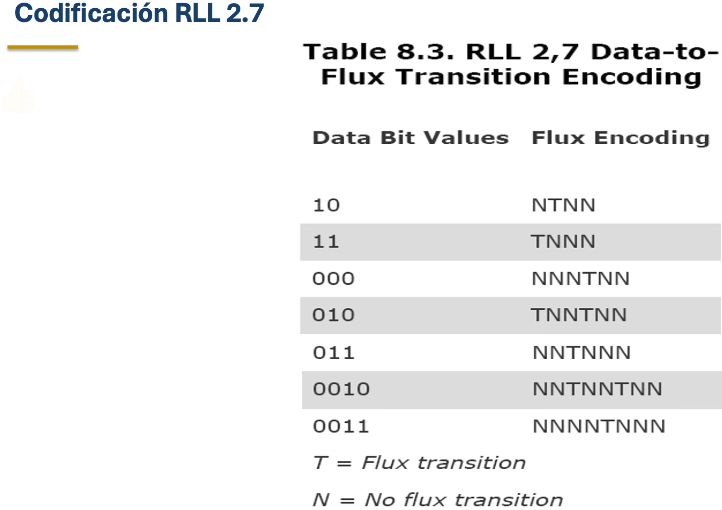

comparativa códigos

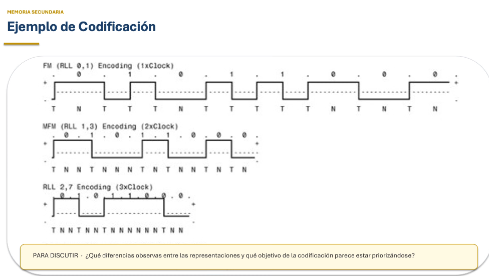

ss

## Mecanismo de direccionamiento

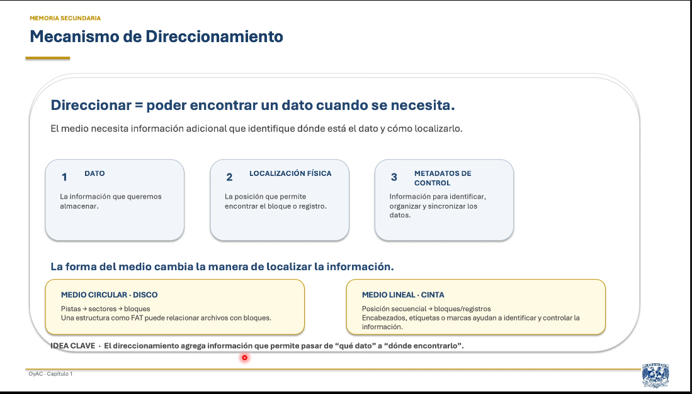

Almacenamiento optico

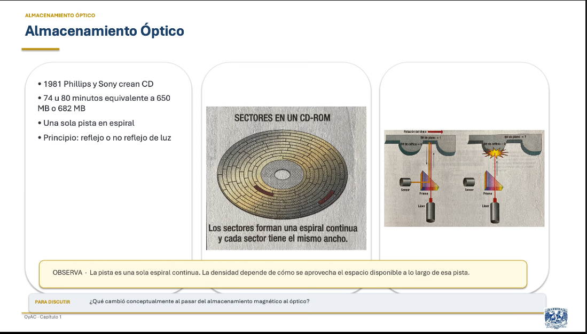

Espiral de un cd

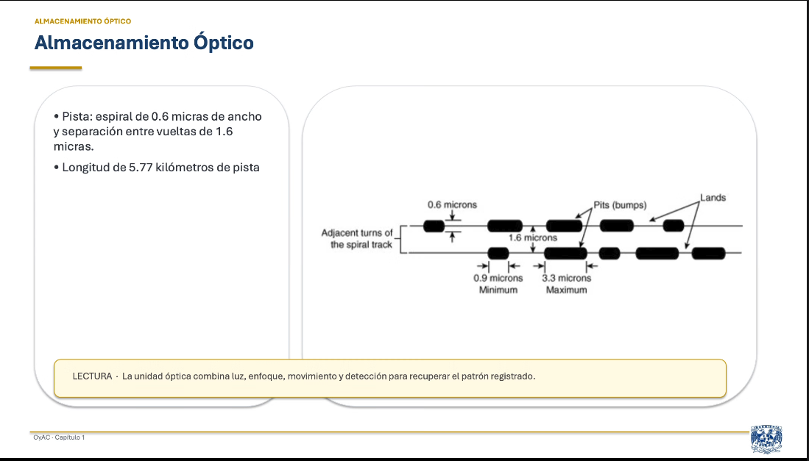

CD-RW

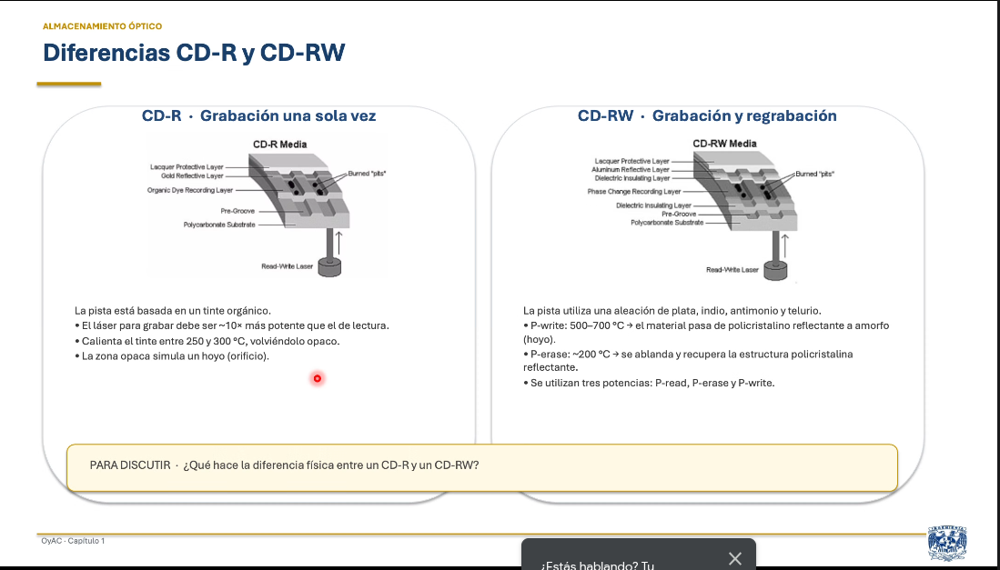

